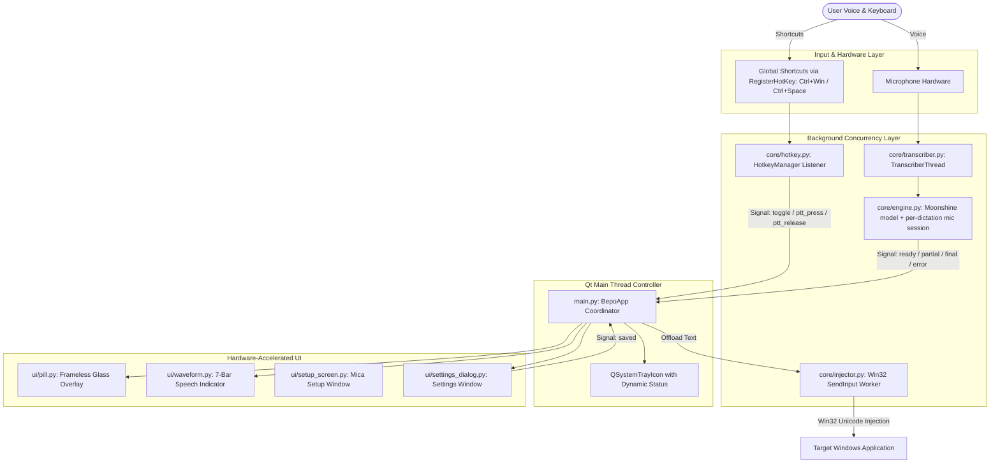
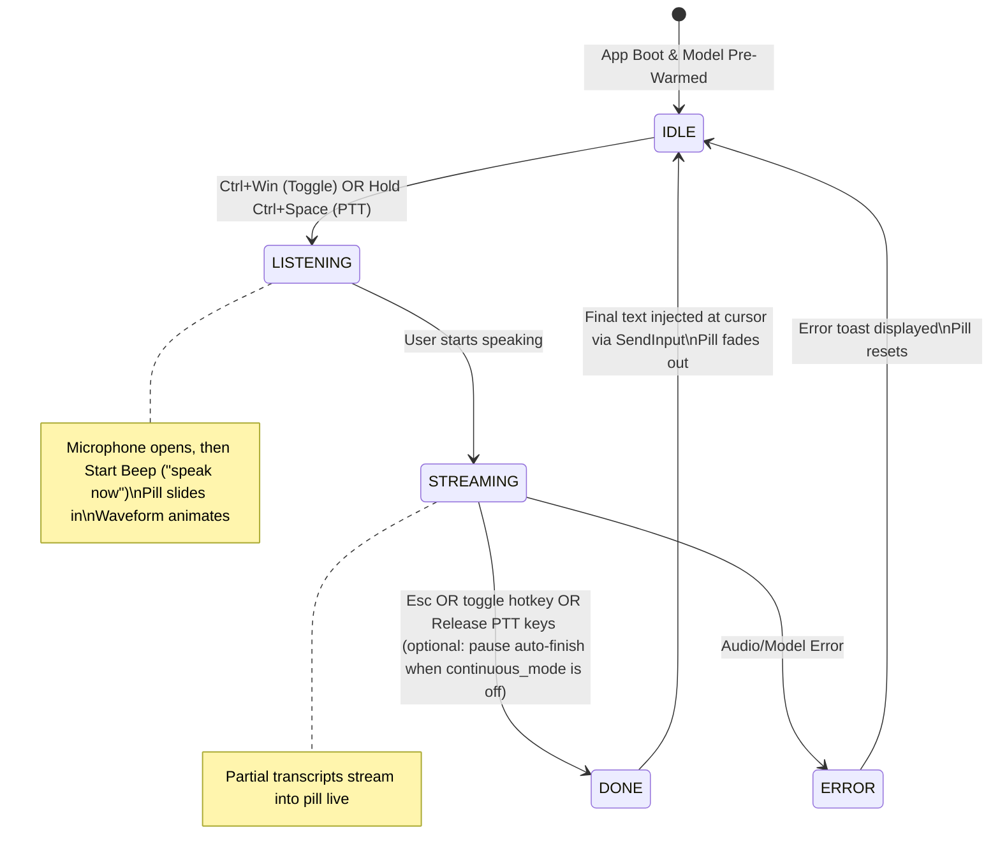

# Bepo — Agent & Contributor Technical Guide

**Bepo** is a blazing-fast, privacy-first Windows voice dictation application powered by **Moonshine AI**'s local on-device streaming model and **PySide6**.

This document is the engineering reference for AI agents and human contributors working on the Bepo codebase. It outlines core architectural invariants, concurrency contracts, platform-specific APIs, and conventions that must be adhered to.

---

## 🏛️ System Architecture

Bepo follows a decoupled, event-driven architecture centered around Qt signals and Win32 low-level hooks.



---

## 📁 Module Inventory & Responsibilities

| Module | Purpose | Key Classes & Functions | Crucial Details |
|---|---|---|---|
| [`main.py`](main.py) | Application Lifecycle & Hub | `BepoApp`, `main()`, `_make_tray_icon` | Coordinates all sub-components, connects all Qt signals, applies settings live (`apply_settings`), schedules the idle memory trim. **Import order matters:** `bootstrap.early_start()` runs before the PySide6 imports (see §8). |
| [`core/transcriber.py`](core/transcriber.py) | Dictation Sessions | `TranscriberThread` | Qt-facing wrapper: loads/reloads the model on a background thread, opens and **closes** a microphone session per dictation, applies settings at runtime. Emits `ready`, `loading`, `partial_text`, `segment_text`, `final_text`, `error`. Call `start_loading()` only after connecting signals. |
| [`core/engine.py`](core/engine.py) | Speech Engine (no Qt) | `EngineSettings`, `load_transcriber()`, `open_session()`, `Preloader` | All Moonshine specifics: model loading, per-dictation `MicTranscriber` on a shared model, key terms, early preload thread. |
| [`core/smartformat.py`](core/smartformat.py) | Spoken Punctuation & Numbers (no Qt) | `smart_format()`, `normalize_numbers()` | Conservative rewrites of spoken punctuation, numbers, percent/dollars and e-mail/domains. Called from `clean_transcript(smart_formatting=...)`, gated by `smart_formatting`. Anything ambiguous ("one", "the period was long") must be left alone. |
| [`core/guide.py`](core/guide.py) | Help Content (no Qt) | `TOPICS`, `shortcuts()`, `disabled_reason()` | The shortcuts and spoken phrases the Help window teaches, each with a spoken → typed example. `tests/test_guide.py` runs every phrase and example through the real parsers, so **when you add or change a voice command or smart-format rule, update `core/guide.py` too** or that test (and the Help window) goes stale. |
| [`core/formatting.py`](core/formatting.py) | Spoken Layout (no Qt) | `parse_format_command()`, `ListState` | Whole-utterance "new line / numbered list / next item / end list" commands and the list state machine (`compose()` decides marker, line break or space). Gated by `voice_formatting`. |
| [`core/config.py`](core/config.py) | Settings (no Qt) | `DEFAULT_CONFIG`, `normalize()`, `load_config()`, `save_user_config()` | Single source of truth for settings: defaults, validation, merging bundled + user config, saving only non-default values. |
| [`core/bootstrap.py`](core/bootstrap.py) | Early Start-up (no Qt) | `early_start()` | Logging, single-instance mutex, model preload — run before Qt is imported so the model loads in parallel with the UI. |
| [`core/audio_devices.py`](core/audio_devices.py) | Microphone List | `list_input_devices()`, `resolve_device()` | Input devices of the default host API; saved device name -> index (falls back to the system default if unplugged). |
| [`core/startup.py`](core/startup.py) | Start With Windows | `set_enabled()`, `is_enabled()` | HKCU Run-key entry; repaired at launch if the install moved (frozen builds only). |
| [`core/memory.py`](core/memory.py) | Idle Memory | `trim_working_set()` | `EmptyWorkingSet` after 15 s idle: frees physical RAM without unloading the model. |
| [`core/hotkey.py`](core/hotkey.py) | Global Shortcuts | `HotkeyManager`, `parse_hotkey()` | Dispatches the toggle (default `Ctrl+Win`), Push-to-Talk (default `Ctrl+Space`) and Undo-last-dictation (default `Alt+Win+Z`) shortcuts, all configurable. The undo default must not start with the toggle combination: `Ctrl+Win` fires as soon as both keys are down, so `Ctrl+Win+Z` would start dictation first. Emits thread-safe Qt signals, and `registration_issue` when a shortcut can't be registered. |
| [`core/injector.py`](core/injector.py) | Active Cursor Injection | `enqueue_injection()`, `inject_text()`, `configure()` | Injects text via Win32 `SendInput` with UTF-16 surrogate support, on one sequential worker thread. Falls back to clipboard paste and restores the previous clipboard. Never touches the clipboard otherwise (unless the opt-in `clipboard_safety_net` is on). |
| [`ui/settings_dialog.py`](ui/settings_dialog.py) | Settings Window | `SettingsDialog`, `HotkeyEdit` | Emits `saved(config, launch_at_startup)`; never touches the running app itself. Downloads a not-yet-installed model (with progress) before saving. |
| [`ui/help_dialog.py`](ui/help_dialog.py) | Help Window | `HelpDialog`, `HelpState` | Tray → Help. One scrolling page of cards (shortcuts, then one card per topic) plus a pinned *Try it* text box that Bepo types into like any other app. `BepoApp` passes the live shortcut labels and config via `set_state()` (also while the window is open); it opens once on first launch (`show_help_once`, marker `%LOCALAPPDATA%\Bepo\welcomed`). Esc is swallowed: it finishes a dictation and must not close the window. |
| [`ui/smooth_scroll.py`](ui/smooth_scroll.py) | Smooth Wheel Scrolling | `SmoothScrollArea` | `QScrollArea` whose mouse wheel eases to a target (notches add up) instead of jumping 60 px. Touchpads, the scroll bar and the keyboard keep Qt's behaviour. Use it for any long scrolling window (Settings and Help do). |
| [`ui/pill.py`](ui/pill.py) | Floating Glass Overlay | `PillWindow`, `DotWidget`, `PillState` | Frameless, always-on-top, never-activating (`WS_EX_NOACTIVATE`) overlay that paints its own translucent glass and shadow. Multi-monitor cursor tracking. |
| [`ui/waveform.py`](ui/waveform.py) | Speech Indicator | `WaveformWidget` | 7-bar animated indicator with smooth easing. The motion is simulated, not measured from the mic (`set_level()` exists if a real level is ever wired in). |
| [`ui/setup_screen.py`](ui/setup_screen.py) | First-run Onboarding | `SetupScreen`, `DownloadThread` | Downloads model weights if missing, with progress, Retry/Quit on failure, and Mica backdrop. Closing it before completion quits the app. |
| [`ui/about_dialog.py`](ui/about_dialog.py) | Credits & License Notice | `AboutDialog` | Shows creator attribution (Gopinath), GitHub link, copyright and GPLv3 notice. Version comes from `version.py`. |
| [`setup/model_downloader.py`](setup/model_downloader.py) | Model Cache & Bundling | `is_model_downloaded()`, `download_model()`, `export_model_for_bundling()` | Manages model caches under `%LOCALAPPDATA%\moonshine_voice\...` and supports pre-bundled models. A model only counts as present if **all** files in `REQUIRED_MODEL_FILES` exist. `python -m setup.model_downloader <dir>` bundles it for releases and exits non-zero on failure. |
| [`config.json`](config.json) | Default Settings | JSON | Shipped defaults. Effective config = `DEFAULT_CONFIG` (core/config.py) < `config.json` < `%LOCALAPPDATA%\Bepo\config.json` (user overrides, written by the Settings window). |
| [`version.py`](version.py) | Version | `__version__` | Single source of truth; the release workflow checks the git tag against it. |
| [`tests/`](tests) | Test Suite | `unittest` | Pure-logic tests plus offscreen simulations of whole dictation sessions with fake transcriber/hotkey/pill and mocked `SendInput`/clipboard. |

---

## 🎨 Asset & Brand Specification

Bepo uses a curated mascot identity: the **Bepo Vocalizing Bear**.

| Asset | Path | Format & Dimensions | Intended Usage |
|---|---|---|---|
| **Responsive Logo** | [`assets/logo.svg`](assets/logo.svg) | SVG (Vector, Tight ViewBox `42 85 128 128`) | Vector presentation; contains CSS `prefers-color-scheme` for automatic light/dark switching. |
| **Dark Theme Logo** | [`assets/logo-dark.svg`](assets/logo-dark.svg) | SVG (Vector, `#F8FAFC` Fill) | Dark UI surfaces, system menus, and GitHub dark mode. |
| **Light Theme Logo** | [`assets/logo-light.svg`](assets/logo-light.svg) | SVG (Vector, `#1E293B` Fill) | Light backgrounds and print media. |
| **Master Icon (PNG)** | [`assets/icon.png`](assets/icon.png) | RGBA PNG (256×256) | High-DPI application icon, setup screens, and web documentation. |
| **Windows Icon (ICO)** | [`assets/icon.ico`](assets/icon.ico) | Multi-Resolution ICO (16 to 256px) | Windows Executable (`build.bat`), Inno Setup Installer (`installer.iss`), taskbar, and desktop shortcuts. |

---

## 🔄 Lifecycle & State Machine



---

## ⚠️ Core Invariants & Engineering Gotchas

### 1. Moonshine Voice API Contracts
- **Correct API** (see `core/engine.py`):
  ```python
  model = Transcriber(str(model_dir), ModelArch.SMALL_STREAMING)       # once, background thread
  mic = (MicTranscriber().use_transcriber(model).update_interval(1.0)  # per dictation
         .on_text(on_partial).on_line(on_line).on_error(on_error))
  mic.load()      # cheap: only creates the stream
  mic.start()     # opens the microphone
  mic.stop()      # flushes buffered audio, fires on_line
  mic.close()     # releases the microphone; the shared model stays loaded
  ```
- **Prohibited:** Never call `transcriber.run()`. It does not exist in `moonshine_voice.MicTranscriber` and will cause a runtime attribute error.
- **Never let moonshine download implicitly:** models are loaded from a directory we located (`find_installed_model`), so a missing model is a UI flow (setup screen / Settings), not a silent multi-second download.
- **Pre-Warming:** loading the ONNX/ORT graph takes ~0.6-1.2 s. Always load on a worker thread, never on the Qt main thread.
- **`stop()` flushes:** `mic.stop()` transcribes the audio still buffered and fires `on_line` **synchronously, during the call**. `TranscriberThread._recording` therefore stays `True` until `stop()` returns, otherwise the last utterance is silently dropped.
- **`stop()` does NOT release the microphone.** `MicTranscriber.stop()` leaves the sounddevice stream open for the life of the object. Only `close()` releases it, so every dictation uses its own short-lived `MicTranscriber` (`tests/test_engine.py` pins this behaviour).
- **Update interval** is fixed when the stream is created (per session); key terms (`set_keyterms`) and the device apply live/next session; only a different *model* needs a reload.

### 2. Threading & Qt Signal Discipline
- Moonshine audio callbacks (`on_text`, `on_line`, `on_error`) execute on native background worker threads.
- **Rule:** Never mutate PySide6 widgets directly from non-GUI threads.
- **Pattern:** Use `Signal` definitions on worker classes to dispatch events safely to Qt slots decorated with `@Slot()`.

### 3. Non-Blocking, Ordered Text Injection
- `SendInput` can introduce micro-freezes on the GUI thread, and sentences must never interleave.
- All typing and deleting goes through `enqueue_injection()` / `enqueue_deletion()`, which feed a single sequential daemon worker thread. Never call `inject_text()` from the Qt thread.

### 3b. Live Session vs. Final Transcript
- In continuous toggle mode every utterance is handled live (`_on_segment`): typed, executed as a voice command, or dropped. The transcriber's final text still contains sentences that were typed and later deleted (and the delete commands themselves), so `_on_final` must **not** re-parse it when `_session_handled_segments > 0`. Only PTT, non-continuous mode, or a session where nothing was handled live injects the full transcript.

### 3c. Line Breaks & List State
- `
` in injected text is sent as a real Enter/Shift+Enter keystroke (`injector._send_text`), never as a Unicode `
` (many apps ignore it). `line_break_key` (`shift_enter` default, so chat boxes never send) is applied via `injector.configure()`.
- Every typed segment records the `ListState` snapshot from *before* it (`_session_segment_states`, parallel to `_session_segments`). "Scratch that", "Delete all" and "Delete last word" restore it so numbering stays correct; keep both lists in sync when adding anything that edits `_session_segments`.
- Layout commands only work live (continuous toggle mode). The full-transcript path (PTT / non-continuous) types text as spoken.

### 4. Windows 11 DWM Effects & Focus
- The setup screen and About dialog use `DwmSetWindowAttribute` with:
  - `DWMWA_SYSTEMBACKDROP_TYPE = 38` and `DWMSBT_MAINWINDOW = 2` (Mica)
  - `DWMWA_WINDOW_CORNER_PREFERENCE = 33` and `DWMWCP_ROUND = 2` (Rounded Corners)
- The pill does **not** use DWM blur: it paints its own translucent capsule and sets `WS_EX_NOACTIVATE` (`0x08000000`) via `ctypes.windll.user32.SetWindowLongW` so it never steals focus.

### 5. Keystroke Injection & Process Elevation
- Win32 UIPI (User Interface Privilege Isolation) prevents standard processes from sending `SendInput` messages to windows running with elevated (Administrator) privileges.
- If users report that dictation does not type into Admin Command Prompt or Task Manager, they must launch Bepo as Administrator.
- Before typing, `_release_held_keys()` sends key-ups only for modifiers/Space that are *physically still held* (e.g. after PTT), so characters aren't interpreted as shortcuts. There is no dependency on the `keyboard` package any more — don't re-add global keyboard hooks.

### 6. Privacy Contract (public promises in the README)
- **Clipboard:** never read or written by default. The paste fallback must restore the previous clipboard; `clipboard_safety_net` is opt-in.
- **Logs:** never include dictated text — log character counts only.
- **History:** the opt-in `keep_history` list lives in memory only (never disk, never logs) and touches the clipboard only when the user clicks an entry.
- **Network:** only the one-time model download; nothing during dictation.
- **Hotkeys:** `RegisterHotKey` plus `GetAsyncKeyState` polling of Esc/PTT keys only. No global keyboard hooks.

### 7. Config & Hotkeys
- A new setting needs: an entry in `DEFAULT_CONFIG` and validation in `normalize()` (core/config.py), `config.json`, a control in `ui/settings_dialog.py` (+ round-trip test), the place where it is applied (`BepoApp.apply_settings`), and the README Settings section. The Settings window must apply it live; if it genuinely can't, say so in the UI.
- `RegisterHotKey` is system-wide: a registered shortcut is removed from every other app. Failures must be surfaced (`registration_issue` → tray message), never silent.
- Shortcuts can change at runtime: `HotkeyManager.reconfigure()` re-registers on a fresh message-loop thread; `suspend()`/`resume()` are used while the Settings window records a new shortcut (otherwise Bepo's own shortcut would fire).

### 8. Start-up Order & Signals
- `main.py` runs `bootstrap.early_start()` *before* importing PySide6 (only when executed as `__main__`): logging, the single-instance check, then the model starts loading on a background thread while Qt is imported and the UI is built (~0.3 s faster). Keep `core/bootstrap.py`, `core/config.py`, `core/engine.py`, `setup/model_downloader.py` free of Qt imports, and keep heavy imports (`moonshine_voice`, `sounddevice`) lazy inside functions.
- With the preload the model can already be in memory when `BepoApp` is created, so `TranscriberThread` does **not** start loading in its constructor: call `start_loading()` after `ready`/`error` are connected, or the signal fires with nobody listening.
- A second launch exits right after the mutex check, before anything heavy is loaded.
- Developer/test hook: set `BEPO_MUTEX_NAME` to run a second instance beside a real one (benchmarks, smoke tests of a frozen build).

### 9. Microphone Lifecycle
- The microphone is open only between `TranscriberThread.start_recording()` and the end of `_async_stop()` (which closes the session). The start earcon plays *after* the microphone opened, so it means "speak now".
- If a new feature opens a stream, it must close it; the README promises the Windows mic-in-use indicator is off between dictations.

### 10. Text Must Never Be Cropped
- Don't give windows that show text a hard-coded height. `SetupScreen` sizes itself from its content (`_fit_to_content()`, called after every state change) and every message label is word-wrapped.
- Anything that can contain arbitrary text (exceptions, URLs, file paths) must go through `ui.setup_screen.breakable()` before it is shown in a wrapped label. Qt only wraps at spaces, so one long unbroken token otherwise makes the label wider than the window and it gets cropped. `tests/test_setup_screen.py` checks every state, including worst-case errors.

---

## 💻 Developer & Agent Tooling

### Syntax & Compilation Check
Validate all Python files across all packages without running GUI event loops:

```powershell
python -c "import glob, py_compile; [py_compile.compile(f, doraise=True) for f in ['main.py', 'version.py'] + glob.glob('core/*.py') + glob.glob('ui/*.py') + glob.glob('setup/*.py') + glob.glob('tests/*.py')]; print('All files compiled successfully!')"
```

### Tests
Safe to run anywhere: `SendInput`, the clipboard, the mic and the model are mocked, and Qt runs offscreen.

```powershell
python -m unittest discover -s tests -v
```

### Running Locally
```powershell
python main.py
```

### Executable Build & Asset Verification
Run the build script to generate the standalone release:

```powershell
.\build.bat
```

- **Keep the build lean:** it collects only the Qt modules the app imports (`--collect-binaries moonshine_voice`, no `--collect-all PySide6`). Re-adding `--collect-all PySide6` grows the package from ~230 MB to ~800 MB with no benefit.
- **Release gate:** `release.yml` launches the packaged app (offscreen Qt, `BEPO_MUTEX_NAME` set) and fails the release unless it logs `Speech model ready`. To reproduce locally, run `dist\Bepo\Bepo.exe` and check `%LOCALAPPDATA%\Bepo\logs\bepo.log`.

---

<p align="center">
  <em>Keep Bepo fast, elegant, and uncompromisingly private.</em>
</p>
