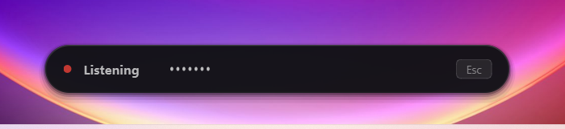
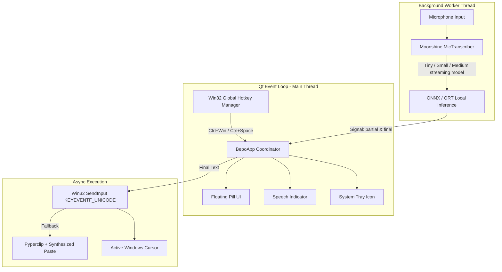

<p align="center">
  <picture>
    <source media="(prefers-color-scheme: dark)" srcset="assets/icon.png">
    <source media="(prefers-color-scheme: light)" srcset="assets/icon.png">
    
  </picture>
</p>

<h1 align="center">Bepo: Voice Typing for Windows</h1>

<p align="center">
  <strong>Blazing fast, 100% offline voice typing for Windows (English only).</strong><br>
  Powered by <a href="https://github.com/usefulsensors/moonshine">Moonshine AI</a> and <a href="https://wiki.qt.io/Qt_for_Python">PySide6</a>.
</p>

<p align="center">
  <a href="#-quick-start"></a>
  <a href="#-quick-start"></a>
  <a href="#option-b-run-from-source"></a>
  <a href="LICENSE"></a>
  <a href="#-privacy--security"></a>
  <a href="#-architecture"></a>
</p>

<p align="center">
  <a href="#-features">Features</a> •
  <a href="#-why-moonshine">Why Moonshine</a> •
  <a href="#-quick-start">Quick Start</a> •
  <a href="#-keyboard-shortcuts--usage">Usage</a> •
  <a href="#-voice-deletion--editing-commands">Voice Deletion</a> •
  <a href="#-spoken-emoji-dictation">Emojis</a> •
  <a href="#-intelligent-filler-word-filter">Filler Filter</a> •
  <a href="#-architecture">Architecture</a> •
  <a href="#-settings">Settings</a> •
  <a href="#-performance--resource-use">Performance</a> •
  <a href="#-contributing">Contributing</a>
</p>

<p align="center">
  
</p>

---

## 🐻 What is Bepo?

**Bepo** is a native, privacy-first voice dictation tool built **exclusively for Windows** and **tailored specifically for English speech recognition**. Tap a global shortcut (`Ctrl + Win` for hands-free or hold `Ctrl + Space` for Push-to-Talk) and dictate in any text area — IDEs, web browsers, chat clients, spreadsheets, or command terminals.

> 💡 **Scope & Focus:** Bepo exclusively targets **Windows 10 & 11** and **English** speech. By avoiding cross-platform overhead and focusing purely on native Win32 APIs (`SendInput`, `RegisterHotKey`) and lightweight streaming models, Bepo delivers instant, distraction-free typing without resource bloat.

Unlike traditional cloud voice assistants, Bepo runs **Moonshine AI's quantized streaming speech model locally on your hardware**:
- 🚫 **Zero audio sent to the cloud**
- 🚫 **No API keys or recurring subscriptions**
- ⚡ **Instant streaming transcription with a live floating overlay**
- 🎯 **Native Unicode typing via Win32 `SendInput`**

> ### 🎙️ Why Bepo Exists
> *"I wasted hours fighting the built-in Windows Voice Typing (`Win + H`) after it repeatedly broke and refused to cooperate. Offline Whisper tools weren't the answer either — they were sluggish, consumed gigabytes of RAM, and were overloaded with features and menus I never needed. I built Bepo out of pure frustration: a blazing-fast, zero-bloat, 100% offline dictation tool for Windows that just works.*
>
> *If you give Bepo a try, feel free to share your feedback or open an issue if you run into any trouble — I'd love to hear how it works on your setup!"*  
> — **Gopinath** ([@Gopinathsgn](https://github.com/Gopinathsgn))

---

## ✨ Features

| Feature | Description |
|---|---|
| 🔒 **100% Offline & Private** | Speech recognition runs entirely on your PC — your voice never leaves your computer. (The model is downloaded once on first run; the installer already bundles it.) |
| 🪶 **Ultra Lightweight** | Sits quietly in your Windows system tray at ~0% CPU. The microphone is only open while you dictate, and Windows can reclaim the model's RAM whenever Bepo is idle. See [Performance](#-performance--resource-use). |
| ⚡ **Sub-Second Streaming** | Powered by Moonshine's streaming speech models (Tiny, Small or Medium — your choice) with real-time word output. |
| 🔄 **Continuous Dictation** | Streams and types sentence-by-sentence live into your active app without cutting off when you pause to think. |
| ⌫ **Voice Deletion Commands** | Speak commands like *"Scratch that"*, *"Delete last word"*, or *"Clear all"* to instantly erase typed words. |
| 🎙️ **Dual Input Modes** | **Toggle Mode** (`Ctrl + Win`) for hands-free streaming and **Push-to-Talk** (`Ctrl + Space`) for quick replies. |
| 🧹 **Filler Word Filter** | Automatically scrubs vocal hesitations (`um`, `uh`, `erm`, `er`, `ah`, `hmm`) for clean, professional transcripts. |
| 🔢 **Smart Formatting** | *"comma"*, *"question mark"*, *"open quote"* become punctuation; *"twenty five"* → 25, *"fifty percent"* → 50%, *"jane at gmail dot com"* → jane@gmail.com. Small numbers (one–ten) stay words. Turn it off in Settings. |
| 📝 **Line Breaks & Lists** | Say *"new line"*, or *"numbered list"* / *"bullet list"* then *"next item"* and *"end list"* to lay out lists by voice. |
| 😊 **Spoken Emoji Dictation** | Speak emojis naturally (*"fire emoji"* → 🔥, *"thumbs up emoji"* → 👍, *"rocket emoji"* → 🚀) with zero false positives. |
| 🪟 **Floating Glass Overlay** | Minimalist always-on-top pill with a dark translucent glass look, soft shadow, and smooth slide animations. It never steals focus. |
| 🌊 **Speech Indicator** | Animated 7-bar waveform that shows when your speech is being recognised. |
| ⌨️ **Universal Injection** | Injects characters directly at your active cursor via Win32 `SendInput`. Your clipboard is left untouched (an optional clipboard safety net is available). |
| ⚙️ **Settings Window** | Change shortcuts, microphone, speech model, custom words and more from the tray — applied instantly, no restart, no config files. |
| 🖥️ **Smart Monitor Detection** | Automatically floats above the monitor where your mouse cursor is currently focused. |

---

## 📊 Comparison

How Bepo compares to existing dictation tools and models:

| Feature | Bepo 🐻 | Offline Whisper Tools | Windows Dictation (`Win + H`) | Cloud AI Speech APIs |
|---|:---:|:---:|:---:|:---:|
| **Platform** | **Windows 10 / 11 Native** | Cross-platform | Windows Only | Web / Any |
| **Language** | **English (Laser-Tuned)** | Multilingual | Multilingual | Multilingual |
| **System Resources** | **Lightweight (~0% idle CPU; model RAM handed back to Windows when idle)** | ❌ **Heavy & demanding** (Consumes high RAM/VRAM, spins laptop fans) | Low local (Cloud-offloaded) | Low local (Cloud-offloaded) |
| **Simplicity & Purpose** | **Focused solely on fast, instant typing** | ❌ **Over-engineered with feature bloat** (Complex settings, bulky menus) | Basic / Inflexible | Raw developer API |
| **Privacy / Cloudless** | **100% Local** | **100% Local** | ❌ Cloud Required | ❌ Cloud Required |
| **Cost & Accounts** | **Free Forever (No API Key)** | Free | Microsoft Account Required | ❌ Paid Subscriptions / Per-Minute Fees |
| **Push-to-Talk (`Ctrl + Space`)** | ✅ **Instant & Native** | ⚠️ Clunky or unsupported | ❌ No | ❌ No |
| **Streaming Response** | **Live sub-second word streaming** | ⚠️ Noticeable lag (Waits for full audio buffer) | Variable (Dependent on network ping) | 500ms – 2000ms |
| **Overlay UI Quality** | **Floating Glass Pill** | Bulky Electron / Cluttered UI | Rigid Windows bar | None / Browser view |

---

## 🧠 Why Moonshine?

*"Whisper Large V3 and NVIDIA NeMo models are top-tier — why doesn't Bepo use them?"*

Because Bepo is a background tool for ordinary laptops. It has to sit in your tray, type the moment you speak, and never need a GPU, gigabytes of RAM or a fan that spins up. [Moonshine](https://github.com/moonshine-ai/moonshine) is built for exactly that: small, CPU-first, and streaming.

| | Moonshine streaming (Bepo) | Whisper Large V3 |
|---|---|---|
| **Download size** | **45 – 269 MB** (Tiny / Small / Medium) | ≈ 3 GB of weights |
| **Memory while loaded** | **≈ 90 – 320 MB**, handed back to Windows when idle | Several GB; ≈ 10 GB of VRAM is the usual guideline for the reference implementation |
| **GPU needed?** | **No** — runs on a normal CPU through ONNX Runtime | Practically yes for real-time use |
| **Live streaming** | **Yes** — caches work between updates, so words appear as you speak | No — always processes a fixed 30-second window |
| **English accuracy** ¹ | Medium **6.65 %**, Small 7.84 %, Tiny 12.0 % word error rate | 7.44 % word error rate |
| **Languages** | English only in Bepo | Many |

¹ Average word error rate over the Open ASR benchmark sets (AMI meetings, Earnings-22, GigaSpeech, LibriSpeech, SPGISpeech, TED-LIUM, VoxPopuli), as published by Moonshine in its [streaming paper](https://arxiv.org/abs/2602.12241) and [docs](https://moonshine-voice.readthedocs.io/en/latest/moonshine-vs-whisper/) — vendor figures, not Bepo's own tests. These sets are much harder than ordinary dictation (meetings, phone-style audio), so real-world error rates on clear speech are lower: all three models scored about 2 % on Bepo's own clean read-aloud test. Bepo's measured size, memory and CPU numbers are in [Performance](#-performance--resource-use).

**In short**
- **Light:** the default Small model needs about 142 MB on disk and about 175 MB of RAM, and Bepo trims even that after 15 idle seconds.
- **Fast to respond:** Moonshine's own benchmarks put its response latency around 0.1 s, against roughly 11 s for Whisper Large V3 on the same laptop. In Bepo, a finished sentence is typed about half a second after you stop speaking.
- **No GPU required:** it works on integrated graphics and older CPUs. It does use real CPU while you speak (about 1.4 – 2 cores on the Small model in our tests) and almost none the rest of the time.
- **Accurate enough to prefer:** Moonshine Medium Streaming matches or beats Whisper Large V3 on English in Moonshine's benchmarks with roughly a sixth of the parameters.

**What about NVIDIA NeMo (Parakeet / Canary)?** They are excellent, and models such as Parakeet can run on a CPU through ONNX exports. They are still larger (hundreds of millions to a billion parameters, with GB-scale weights) and the NeMo toolkit itself is built around PyTorch and NVIDIA GPUs, which is the opposite of a small, drop-in Windows tray app.

**When Whisper is the better tool:** you need many languages, or you are batch-transcribing recordings on a GPU. Bepo is deliberately narrower: English, live, local and light.

**Will Bepo switch models if a better one comes along?** Moonshine's models are fantastic, and Bepo's goal is a small memory footprint with reasonable accuracy. If a model fits that goal better, I'll gladly switch when I have the time. — Gopinath

---

## 🚀 Quick Start

### Option A: Standalone Installer (Recommended)

1. Download the latest `Bepo-Setup-v<version>.exe` from the [Releases](../../releases) tab.
2. Run the installer (installs into `%LOCALAPPDATA%`, **no Admin rights required**).
3. Launch Bepo from the Start Menu or Desktop shortcut.
4. Press `Ctrl + Space` or `Ctrl + Win` to begin dictating!

> 🛡️ **Windows SmartScreen:** the installer is not code-signed yet, so Windows may show *"Windows protected your PC"*. Click **More info → Run anyway**. If you'd rather not trust a binary, [run from source](#option-b-run-from-source) — the whole app is plain, readable Python (about 4,000 lines).

### Option B: Run from Source

#### Prerequisites
- **Operating System:** Windows 10 (Build 19041+) or Windows 11 (64-bit) — *exclusively Windows*
- **Language:** English 
- **Python:** 3.10, 3.11, 3.12, or 3.13
- **Hardware:** Microphone with standard Windows audio drivers

```powershell
# 1. Clone repository
git clone https://github.com/Gopinathsgn/bepo.git
cd bepo

# 2. (Optional) Create virtual environment
python -m venv .venv
.\.venv\Scripts\Activate.ps1

# 3. Install dependencies
pip install -r requirements.txt

# 4. Launch Bepo
python main.py
```

> **Note on First Launch:** If the Moonshine model is not pre-cached, Bepo's setup screen will download the lightweight quantized model (~150MB) once. After that, Bepo is completely offline.

---

## 🎯 Keyboard Shortcuts & Usage

### 🎙️ 1. Toggle Mode (Hands-Free Continuous Dictation)
- **Shortcut:** `Ctrl + Win`
- **Behavior:** Press once to begin recording. Speak naturally.
- **Continuous Live Typing:** Bepo injects completed sentences live into your active window as you finish each clause. You can pause to think without the app closing!
- **Finish & Stop:** Press `Ctrl + Win` again or tap **`Esc`** to finish your dictation session.
- **Safety Timeout:** Automatically stands down after 3 minutes of complete silence (configurable) and releases the microphone.

### ⚡ 2. Push-to-Talk (Hold-to-Speak)
- **Shortcut:** Hold `Ctrl + Space`
- **Behavior:** Keep both keys held while speaking. Release either key when done.
- **Result:** Injects speech immediately upon release — ideal for fast chat replies.

### ⌨️ 3. Finish & Type Key
- **Shortcut:** `Esc` (while recording)
- **Behavior:** Flushes any trailing speech buffer, types the text, and closes the overlay.

### ⚠️ Shortcut conflicts
Global shortcuts are registered system-wide, so while Bepo runs, **`Ctrl + Space` is no longer delivered to other apps** — it is the autocomplete trigger in VS Code, Visual Studio and JetBrains IDEs, and the IME switch on some keyboards. If that bothers you, open **tray → Settings…** and record a different push-to-talk shortcut (e.g. `Ctrl+Alt+Space` or `F9`) or disable it — see [Settings](#-settings). If a shortcut can't be registered because another app owns it, Bepo shows a tray notification and the tray menu still works.

---

## ⌫ Voice Deletion & Editing Commands

Correct mistakes seamlessly hands-free using natural voice commands:

| Command | Action | Behavior |
|---|---|---|
| **`"Scratch that"`** or **`"Delete that"`** | Retract last sentence | Erases the most recently injected sentence via high-speed atomic backspacing. Saying it multiple times steps backward through your dictation history! |
| **`"Delete word"`** or **`"Delete last word"`** | Retract last word | Erases the last typed word and its preceding whitespace. |
| **`"Delete last <N> words"`** | Retract multiple words | E.g., *"Delete last 3 words"* or *"Delete last two words"*. |
| **`"Clear all"`** or **`"Delete all"`** | Clear entire session | Erases all text dictated during the current session. |
| **In-Flight Self-Correction** | Immediate replacement | Saying *"We meet at six, scratch that, we meet at seven"* automatically discards the first clause before typing and only injects *"We meet at seven"*. |

> **Contextual Safety:** Spoken commands require whole-utterance isolation or punctuation boundaries. Sentences like *"The cat scratch that tree"* are recognized as normal text and are **never** falsely interpreted as commands.

---

## 📝 Line Breaks & Lists

Lay out what you dictate without touching the keyboard. Say the command as its own phrase and pause briefly:

| Command | What happens |
|---|---|
| **`"New line"`** / **`"New paragraph"`** | Types a line break / a blank line. |
| **`"Numbered list"`** (or *"Bullet list"*) | Starts a list: whatever you say next becomes item `1.` (or `- `), on its own line. |
| **`"Next item"`** | The next thing you say starts item `2.`, `3.`, … A pause in the middle of an item does *not* split it. |
| **`"End list"`** | Leaves list mode; the next sentence starts on a fresh line. |

*Example:* "Shopping list. **Numbered list.** Buy milk. **Next item.** Buy eggs. **End list.**" types:

```
Shopping list.
1. Buy milk.
2. Buy eggs.
```

- **"Scratch that"** takes back a whole list item together with its number, and *"Delete last word"* keeps line breaks intact.
- Line breaks are typed as **Shift+Enter** by default so they never send a chat message. Word, Google Docs and Notion may continue a list on their own after a plain Enter, so if you prefer new list items there, switch **Settings → Dictation → Line break key** to *Enter*. Turn the whole feature off with *Spoken line breaks and lists*.
- Works while typing sentence by sentence (the default). Push-to-talk and *finish at the end* modes type your sentences as spoken, without layout commands.
- Like the editing commands, these only trigger when they are the whole phrase: *"The numbered list is long"* is typed as normal text.

---

## 😊 Spoken Emoji Dictation

Bepo recognizes over 100+ popular emojis spoken naturally. Just say the description followed by **`emoji`** (or `emoticon`):

| What You Say | What Gets Typed |
|---|:---:|
| *"Great job thumbs up emoji!"* | Great job 👍! |
| *"That idea is fire emoji"* | That idea is 🔥 |
| *"Launch the update rocket emoji"* | Launch the update 🚀 |
| *"Thank you so much folded hands emoji"* | Thank you so much 🙏 |
| *"That was hilarious crying laughing emoji"* | That was hilarious 😂 |
| *"Pull request approved check mark emoji"* | Pull request approved ✅ |
| *"Happy birthday celebration emoji!"* | Happy birthday 🎉! |
| *"I was dead skull emoji"* | I was dead 💀 |
| *"Keep it 100 100 emoji"* | Keep it 100 💯 |
| *"Let me think thinking face emoji"* | Let me think 🤔 |
| *"Sending love red heart emoji"* | Sending love ❤️ |

> **Zero False-Positive Protection:** Regular words like *"We lit a fire"* or *"SpaceX built a rocket"* will **never** be turned into emojis. Only phrases followed by the explicit word `"emoji"` are transformed.

---

## 🧹 Intelligent Filler Word Filter

Bepo automatically strips vocalized hesitations and non-lexical disfluencies:
- **Cleaned hesitations:** `um`, `uh`, `erm`, `er`, `ah`, `hmm`, `mm`
- **Grammar & comma cleanup:** Removes dangling commas left behind by pauses (e.g. *"Well, um, hello"* $\rightarrow$ *"Well, hello"*).
- **Sentence capitalization:** Capitalizes the next word automatically if a leading filler was removed (e.g. *"Um, hello world"* $\rightarrow$ *"Hello world"*).

---

### 💡 Tips for Pro Users
- **Elevated / Administrator Windows:** To type directly into elevated consoles (e.g. Administrator PowerShell, CMD, or Task Manager), start Bepo with **"Run as Administrator"**.
- **Optional Clipboard Safety Net:** Bepo never touches your clipboard by default. Turn on **Also keep the dictated text on the clipboard** in Settings (`"clipboard_safety_net": true`) and every sentence also updates the clipboard with the **complete accumulated transcript**, so you can press `Ctrl + V` anywhere to paste the whole session. Note that Windows clipboard history (`Win + V`) and cloud clipboard sync may then store your dictation — leave it off if that matters to you.

---

## 🏗️ Architecture



### Module Directory

```text
bepo/
├── assets/                  # High-res SVG logos, Windows ICO, and PNG assets
│   ├── icon.ico             # Multi-resolution Windows app icon (16x16 to 256x256)
│   ├── icon.png             # 256x256 RGBA application icon
│   ├── logo.svg             # Responsive vector logo with dark/light mode support
│   ├── logo-dark.svg        # Optimized white vector for dark surfaces
│   ├── logo-light.svg       # Dark vector for light backgrounds
│   ├── check.svg            # Checkbox tick used by the Settings window
│   ├── chevron-down.svg     # Dropdown arrow used by the Settings window
│   └── preview-hero.png     # README preview image
├── core/
│   ├── audio_devices.py     # Microphone list / lookup for the Settings window
│   ├── bootstrap.py         # Earliest start-up work (logging, single instance, model preload)
│   ├── cleaner.py           # Non-lexical filler word scrub & grammar normalizer
│   ├── commands.py          # Voice deletion & editing command parser ("Scratch that", etc.)
│   ├── config.py            # Settings: defaults, validation, load/save (pure Python)
│   ├── emoji.py             # Spoken emoji parser (100+ native Unicode glyphs)
│   ├── formatting.py        # "New line", "Numbered list", "Next item" ... (layout commands + list state)
│   ├── engine.py            # Loads the Moonshine model, opens per-dictation mic sessions
│   ├── hotkey.py            # Configurable Win32 RegisterHotKey shortcuts & PTT release watcher
│   ├── injector.py          # Win32 SendInput Unicode injector with sequential queue
│   ├── memory.py            # Hands idle working-set memory back to Windows
│   ├── startup.py           # "Start with Windows" registry entry
│   └── transcriber.py       # Moonshine MicTranscriber lifecycle & signal marshaling
├── ui/
│   ├── about_dialog.py      # Credits & license notice dialog
│   ├── pill.py              # Floating glass overlay with animations (never steals focus)
│   ├── settings_dialog.py   # Settings window (shortcut recorder, model download, ...)
│   ├── setup_screen.py      # First-run setup window with Mica/Acrylic effects
│   └── waveform.py          # 7-bar speech indicator
├── setup/
│   └── model_downloader.py  # Locates, downloads and bundles the Tiny/Small/Medium models
├── tests/                   # Unit & session-flow tests (python -m unittest discover -s tests)
├── config.json              # Default settings (user overrides live in %LOCALAPPDATA%\Bepo)
├── build.bat                # Automated PyInstaller executable build script
├── installer.iss            # Inno Setup Windows installer configuration
├── main.py                  # Application lifecycle coordinator
├── version.py               # Single source of truth for the app version
├── NOTICE                   # Copyright notice
├── THIRD_PARTY_NOTICES.md   # Licenses of bundled components (Moonshine, Qt, ...)
└── requirements.txt         # Core dependencies
```

---

## ⚙️ Settings

Right-click the Bepo tray icon → **Settings**. Everything applies the moment you press **Save** — no restart.

| Section | What you can change |
|---|---|
| **Shortcuts** | Click a box and press the new combination for *Start / stop dictation* and *Push-to-talk*; disable either one; choose whether `Esc` finishes dictation. |
| **Dictation** | Type sentence by sentence while you speak, remove filler words, spoken emoji, spoken line breaks and lists (with the line-break key), optional auto-finish after a pause, and how long silence is tolerated before the microphone is released. |
| **Speech recognition** | **Moonshine model** (Tiny / Small / Medium — a model you haven't used yet is downloaded when you Save), **Responsiveness** (Efficient or Fast), **Microphone** (any input device instead of the Windows default) and **Custom words** (names and jargon Bepo should prefer). |
| **System & privacy** | Start Bepo when you sign in to Windows, and the optional clipboard safety net. |

Your choices are saved to `%LOCALAPPDATA%\Bepo\config.json` (outside the install folder, so updates never overwrite them). Only values that differ from the defaults are written. **Restore defaults** resets the window to the shipped defaults.

<details>
<summary>Advanced: the settings file</summary>

The Settings window edits this JSON file for you; you can also edit it by hand (restart Bepo afterwards). Missing keys fall back to the defaults in [`config.json`](config.json).

```json
{
  "hotkey_toggle": "ctrl+win",
  "hotkey_ptt": "ctrl+space",
  "continuous_mode": true,
  "filter_filler_words": true,
  "enable_emojis": true,
  "smart_formatting": true,
  "safety_idle_timeout_seconds": 180.0,
  "auto_stop_on_pause": false,
  "pause_duration_seconds": 2.0,
  "esc_to_finish": true,
  "clipboard_safety_net": false,
  "keep_history": false,
  "speech_model": "small",
  "responsiveness": "efficient",
  "custom_word_strength": "normal",
  "microphone": null,
  "custom_vocabulary": []
}
```

- `"hotkey_toggle"` / `"hotkey_ptt"`: modifiers (`ctrl`, `alt`, `shift`, `win`) joined with `+`, then a key (`a`–`z`, `0`–`9`, `f1`–`f24`, `space`, `enter`, `tab`, or `win`) — e.g. `"ctrl+alt+d"`, `"f9"`. `""` disables one. Invalid values fall back to the default and show a tray warning.
- `"continuous_mode"`, `"filter_filler_words"`, `"enable_emojis"`, `"esc_to_finish"`: on/off switches for the matching Settings options.
- `"smart_formatting"`: spoken punctuation (*"comma"*, *"question mark"*, *"period"* at the end of a phrase), numbers (*"twenty five"* → 25, *"three point five percent"* → 3.5%) and addresses (*"name at gmail dot com"*).
- `"safety_idle_timeout_seconds"`: silence after which the microphone is released (default 180 s).
- `"auto_stop_on_pause"` / `"pause_duration_seconds"`: with continuous mode off, finish automatically after a pause.
- `"clipboard_safety_net"`: also keep the whole dictated session on the clipboard (off by default — see [Tips](#-tips-for-pro-users)).
- `"keep_history"`: remember the last 10 dictations in memory only (never written to disk or logs) for the tray's *Recent dictations* menu; picking one copies it to the clipboard. Off by default.
- `"speech_model"`: `"tiny"`, `"small"` or `"medium"`.
- `"responsiveness"`: `"efficient"` (live transcript refreshes every 1.0 s, about a third less CPU) or `"fast"` (every 0.5 s).
- `"custom_word_strength"`: `"normal"`, `"strong"` or `"stronger"` — how firmly your custom words are favoured (changing it reloads the speech model). The stronger levels are untuned: use them only if names are still missed.
- `"microphone"`: the exact device name, or `null` for the Windows default.
- `"custom_vocabulary"`: list of words/phrases to bias recognition towards.

</details>

---

## ⚡ Performance & Resource Use

Measured on a Windows 11 laptop with Bepo's own test harness (real Moonshine models, real-time audio feed). Your numbers will differ with your CPU, but the ratios hold.

| | Tiny | Small (default) | Medium |
|---|---|---|---|
| Download size | 45 MB | 142 MB | 269 MB |
| RAM added by the loaded model | ≈ 90 MB | ≈ 175 MB | ≈ 320 MB |
| Model load time | 0.4 s | 0.6 s | 1.2 s |
| CPU while you speak (fast setting) | ≈ 1.3 cores | ≈ 2.1 cores | ≈ 2.3 cores |

- **Responsiveness:** the *Efficient* setting (default) refreshes the live transcript once per second instead of twice, which cut CPU use by about a third in testing (≈ 2.1 → ≈ 1.4 cores with the Small model) with identical text. The price is that a finished sentence is typed about 0.2 s later (≈ 0.47 s instead of ≈ 0.25 s after you stop speaking).
- **Accuracy:** on a clean read-aloud test recording all three models scored the same (≈ 2% word error rate), so differences only show on harder audio — background noise, accents, technical vocabulary. If Small makes mistakes for you, try Medium; if you want the lightest footprint, try Tiny. Add names and jargon under **Custom words**.
- **Idle:** 0% CPU. About 15 seconds after you last dictate, Bepo asks Windows to trim its working set, so the physical RAM held by the model can be used by other apps (it pages back in on demand with no noticeable delay). This does not unload the model.
- **Start-up:** the speech model loads in parallel with the user interface, so Bepo is ready about 1.5 s after launch.
- **Microphone:** only open while you are dictating. It is released after every dictation and by the idle timeout.

---

## 🔨 Packaging & Building

### 1. Compile Executable with PyInstaller
Run the automated build script:

```powershell
.\build.bat
```

This compiles `main.py` into `dist\Bepo\Bepo.exe`, packages all assets, and bundles the Moonshine AI model weights for complete offline zero-download distribution.

### 2. Generate Windows Installer (`.exe`)
Install [Inno Setup 6](https://jrsoftware.org/isdl.php) and compile [`installer.iss`](installer.iss):

```powershell
ISCC.exe installer.iss
```

This outputs `dist\Bepo-Setup-v<version>.exe` (the version comes from [`version.py`](version.py) in CI; pass `/DMyAppVersion=x.y.z` to override it locally) ready for distribution.

Releases are built automatically by GitHub Actions when you push a tag such as `v1.1.1` (the tag must match `version.py`).

Release assets also include a `SHA256SUMS.txt` so you can verify your download.

---

## 🛡️ Privacy & Security

- **Microphone only while dictating:** Bepo opens the microphone when you start and releases it when you finish (or when the idle timeout expires) — Windows' microphone-in-use indicator is off in between.
- **On-device recognition:** Your audio is processed locally. Bepo only uses the network once, to download the speech model on first run (the installer already bundles it) — never during dictation.
- **Clipboard untouched:** Bepo types with `SendInput` and does not read or write your clipboard. Only if `SendInput` fails does it fall back to a paste, and then your previous clipboard text is restored. The optional `clipboard_safety_net` is **off** by default.
- **No keystroke logging:** Bepo registers its two shortcuts with Win32 `RegisterHotKey` (no global keyboard hook) and only polls the state of `Esc` (while recording) and of the push-to-talk keys. No other keystrokes are read.
- **Logs contain no dictated text:** `%LOCALAPPDATA%\Bepo\logs\bepo.log` records diagnostics and character counts only.
- **Open Source Transparency:** The entire source code is available in this repository for inspection and audit. Please report vulnerabilities as described in [SECURITY.md](SECURITY.md).

---

## 🤝 Contributing

Contributions, bug reports, and feature requests are welcome!
1. Fork the repository.
2. Create your feature branch (`git checkout -b feature/amazing-feature`).
3. Run the tests (`python -m unittest discover -s tests`) — see [CONTRIBUTING.md](CONTRIBUTING.md).
4. Commit your changes (`git commit -m "Add amazing feature"`).
5. Push to the branch (`git push origin feature/amazing-feature`).
6. Open a Pull Request.

Please check [`AGENTS.md`](AGENTS.md) for architectural guidelines, thread-safety invariants, and internal conventions.

---

## 📜 License & Credits

Copyright © 2026 **Gopinath** ([@Gopinathsgn](https://github.com/Gopinathsgn)) — see [`NOTICE`](NOTICE).

Distributed under the **GNU General Public License v3.0 (GPLv3)**. See [`LICENSE`](LICENSE) for details.

> 💼 **Commercial & Enterprise Licensing:**  
> For businesses, OEMs, or proprietary products requiring a commercial license or custom integrations without GPLv3 copyleft terms, feel free to reach out at **[sgn@outlook.in](mailto:sgn@outlook.in)**.  
> Commercial licenses cover Bepo's own code only. Third-party components keep their own licenses; in particular, Qt is used under the LGPLv3 and must remain bundled as separate, replaceable libraries.

Bepo bundles third-party components (Moonshine AI speech engine and model, Qt for Python, and others) under their own licenses — see [`THIRD_PARTY_NOTICES.md`](THIRD_PARTY_NOTICES.md).

---

<p align="center">
  Crafted with care for Windows power users. Happy dictating! 🎙️
</p>
